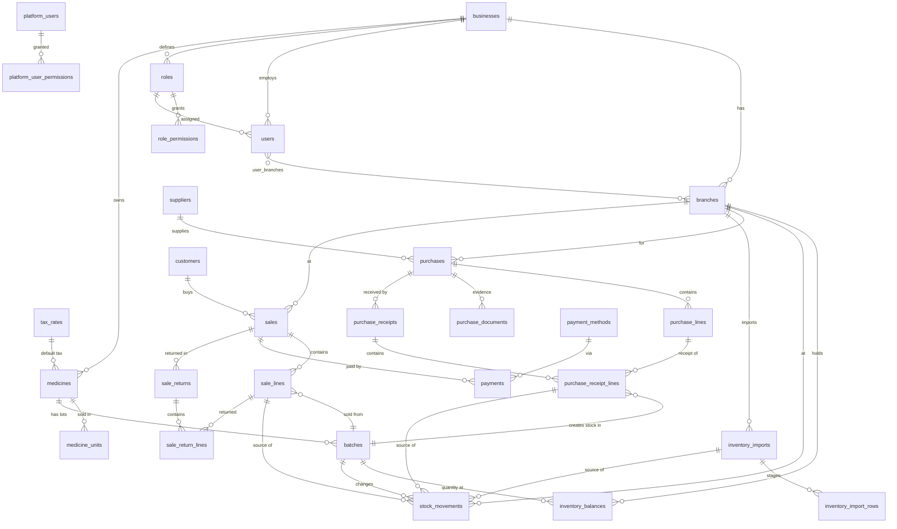

# Pharma ERP — Database Design

| Field | Value |
|---|---|
| Version | 0.1 (draft) |
| Matches | `PRD.md` v0.4, `ARCHITECTURE.md` v0.1 |
| Purpose | The complete data model: tables, columns, keys, constraints, indexes, security, migration and recovery |
| Status | Draft. Items marked **[Pending OQ-n]** depend on open PRD questions; items marked **[DQ-n]** are database decisions listed in Section 14. |

No schema exists in the repository yet (the earlier setup audit found no Prisma schema). This document is the design the schema must implement. It contains no application code; constraints are described in words and tables.

---

## 1. Database Technology

| Topic | Decision |
|---|---|
| Engine | **PostgreSQL** (current supported major version, pinned per environment) |
| Access from code | **Prisma** (migrations and queries). Constraints Prisma cannot express (check constraints, partial indexes, row-level security, triggers, roles) are written as **reviewed hand-written SQL inside Prisma migrations** (Section 10) |
| Extensions | `citext` (case-insensitive email), `pg_trgm` (medicine name search), `pgcrypto` (only if the database generates identifiers or hashes) |
| Tenancy | Shared database, shared schema, `business_id` on every tenant-owned table (ARCHITECTURE 8.2) |
| Time | All timestamps are `timestamptz` stored in UTC; business time zone applies only at presentation and report boundaries |
| Naming | Tables plural `snake_case`; columns `snake_case`; Prisma models map to these names |

---

## 2. Conventions

1. **Primary keys:** `id uuid`, generated by the application as time-ordered UUIDs (better index locality than random UUIDs) **[DQ-1]**. Exceptions are composite keys on pure link tables.
2. **Tenant column:** every tenant-owned table, **including child tables**, carries `business_id uuid not null`. This makes row-level security a single uniform rule and prevents a child row from pointing at another business's parent.
3. **Tenant-safe foreign keys:** each tenant-owned parent has a unique key on `(id, business_id)`, and child tables reference `(parent_id, business_id)`. The database therefore rejects any cross-tenant link even if application code is wrong. Tables below say "tenant-safe FK" to indicate this.
4. **Timestamps:** `created_at` (default now) on all tables; `updated_at` on mutable tables.
5. **Optimistic concurrency:** mutable records edited by several users carry `version integer` (incremented on update): purchases, medicines, roles, customers, suppliers, sales (cancellation).
6. **No hard deletes of business records.** Deactivation uses a status or `is_active`. Purely technical rows (expired sessions, staged import rows, expired idempotency keys) may be purged.
7. **Money:** document totals and payments `numeric(14,2)`; unit prices, unit costs `numeric(14,4)`; tax rates and percentages `numeric(7,4)`. **Never floating point.** Rounding rules are **[Pending OQ-2]**; the stored precision above supports per-line or per-invoice rounding either way.
8. **Quantities:** whole numbers in the **base unit** (`integer`), per PRD MC-FR-002. Selling-unit quantities are converted at the boundary and a snapshot of the conversion is kept on sale lines.
9. **Enumerations:** stable, closed sets use PostgreSQL enums (statuses, movement types); sets owners may change use lookup tables (payment methods, tax rates). The **permission catalog lives in code** (ARCHITECTURE 7.3) and is stored as text codes in the database, validated by the application.
10. **Audit authorship:** records created by a user store `created_by` (user id). Employee activity history (PRD EA-FR-002) is derived from these columns and `audit_events`; there is no separate activity table.

---

## 3. Entity Relationship Diagram

Core relationships (columns omitted; full definitions in Section 4).

Tenant boundary: everything from `branches` down belongs to one `business`. Platform tables (`platform_users`, `platform_user_permissions` and the platform authentication tables) belong to no business. `audit_events` and `idempotency_keys` serve both realms; authentication tables exist once per realm (Section 4.8).

---

## 4. Tables

Legend: **PK** primary key, **FK** foreign key, **UQ** unique, **NN** not null. "Tenant-safe FK" follows convention 3. Columns `id`, `created_at` (and `updated_at`, `version` where stated in conventions) are present on each table unless noted.

### 4.1 Platform realm

**platform_users** — staff of the platform (Super Admin, Platform Admin). Not tenant-owned. (PRD SA-FR-003)

| Column | Type | Notes |
|---|---|---|
| id | uuid | PK |
| email | citext | NN, UQ |
| email_verified | boolean | NN, default false. Required by Better Auth. The password hash is stored in `platform_accounts.password` (argon2id hash only), not on this table (Section 4.8) |
| full_name | text | NN |
| kind | enum(super_admin, platform_admin) | NN |
| status | enum(active, deactivated) | NN, default active |
| failed_login_count, locked_until | integer, timestamptz | Throttling (PRD NFR-SEC-03) |
| last_login_at | timestamptz | |
| created_by | uuid | FK platform_users, null for the bootstrap Super Admin |

**platform_user_permissions** — grants to Platform Admins (minimal list, PRD OQ-13).

| Column | Type | Notes |
|---|---|---|
| platform_user_id | uuid | PK part, FK platform_users |
| permission_code | text | PK part |

Super Admin implicitly holds all platform permissions; the table is used only for Platform Admins.

### 4.2 Tenancy

**businesses** — one pharmacy business (the tenant). (PRD BB-FR-001/003/004)

| Column | Type | Notes |
|---|---|---|
| id | uuid | PK |
| name | text | NN |
| status | enum(active, suspended) | NN, default active |
| status_reason | text | Required when suspended |
| status_changed_by | uuid | FK platform_users |
| currency_code | char(3) | NN. Locked once any sale exists (application rule) |
| locale | text | NN (PRD OQ-16) |
| time_zone | text | NN (IANA name) |
| near_expiry_days | integer | NN, check > 0; no default assumed [Pending OQ-28], set at business creation |
| rounding_method | enum | **[Pending OQ-2]**, column added when the accountant's rule is decided |
| invoice_name, address, phone, tax_registration_no | text | Printed on invoices (PRD BB-FR-003) |
| logo_storage_key | text | Object-storage key |
| version | integer | NN |

**branches** — locations of a business. (PRD BB-FR-002)

| Column | Type | Notes |
|---|---|---|
| id, business_id | uuid | PK; FK businesses; UQ (id, business_id) |
| name | text | NN. UQ (business_id, name) |
| code | text | NN, short code. UQ (business_id, code) |
| address, phone | text | |
| invoice_prefix | text | NN. UQ (business_id, invoice_prefix) **[Pending OQ-39]** |
| is_active | boolean | NN, default true |

**branch_invoice_counters** — per-branch invoice number allocator (ARCHITECTURE 8.4). Kept separate so allocation locks do not contend with branch edits.

| Column | Type | Notes |
|---|---|---|
| branch_id | uuid | PK; tenant-safe FK |
| business_id | uuid | NN |
| last_number | bigint | NN, default 0, check ≥ 0 |

**users** — tenant users (Owner and staff). (PRD UM-FR)

| Column | Type | Notes |
|---|---|---|
| id, business_id | uuid | PK; FK businesses; UQ (id, business_id) |
| email | citext | NN, **UQ across the table** (one business per user, PRD OQ-15) |
| email_verified | boolean | NN, default false. Required by Better Auth. The password hash is stored in `accounts.password` (argon2id hash only), not on this table (Section 4.8) |
| full_name | text | NN |
| phone | text | |
| role_id | uuid | NN, tenant-safe FK roles |
| is_owner | boolean | NN, default false. At least one active owner per business is enforced in the service |
| status | enum(active, deactivated) | NN |
| failed_login_count, locked_until, last_login_at | integer, timestamptz, timestamptz | |
| created_by | uuid | tenant-safe FK users |

Email must not also exist in `platform_users` (a person cannot hold both realms); this cross-table rule is enforced by the service when creating either kind.

**roles** — business-defined permission sets. (PRD UM-FR-002)

| Column | Type | Notes |
|---|---|---|
| id, business_id | uuid | PK; UQ (id, business_id) |
| name | text | NN. UQ (business_id, name) |
| description | text | |
| max_discount_percent | numeric(5,2) | Null = no discount allowed beyond default; role-based limit [PRD OQ-4]. Check 0–100 |
| version | integer | NN |

**role_permissions** — permission codes of a role.

| Column | Type | Notes |
|---|---|---|
| role_id | uuid | PK part; tenant-safe FK roles |
| permission_code | text | PK part |
| business_id | uuid | NN |

**user_branches** — which branches a user may act on (PRD OQ-10).

| Column | Type | Notes |
|---|---|---|
| user_id, branch_id | uuid | PK; tenant-safe FKs |
| business_id | uuid | NN |

Owners are business-wide and need no rows (application rule). A non-owner user must have at least one row (service rule).

### 4.3 Catalog

**tax_rates** — configured tax rates; no rates are shipped by the product (PRD A4). **[Pending OQ-2, OQ-42]**

| Column | Type | Notes |
|---|---|---|
| id, business_id | uuid | PK; UQ (id, business_id) |
| name | text | NN. UQ (business_id, name) |
| rate_percent | numeric(7,4) | NN, check 0–100 |
| is_active | boolean | NN |

**medicines** — medicine master records. (PRD MC-FR-001/003, BR-04)

| Column | Type | Notes |
|---|---|---|
| id, business_id | uuid | PK; UQ (id, business_id) |
| name | text | NN |
| generic_name, manufacturer, dosage_form, strength | text | |
| code | text | Optional barcode/internal code. **UQ (business_id, code) where code is not null** |
| base_unit | text | NN (e.g., tablet) |
| tax_rate_id | uuid | Tenant-safe FK tax_rates, nullable |
| is_active | boolean | NN |
| version | integer | NN |

Regulatory attributes (prescription-only, schedule) are **not included** until **[Pending OQ-7]**. Duplicate medicines (same name, strength, form, manufacturer) produce a warning in the application, so there is no unique constraint on them (PRD MC-FR-001).

**medicine_units** — selling units, conversions and prices. (PRD MC-FR-002, MC-FR-004, OQ-3) **[DQ-2]**

| Column | Type | Notes |
|---|---|---|
| id, business_id | uuid | PK |
| medicine_id | uuid | NN, tenant-safe FK |
| unit_name | text | NN. UQ (medicine_id, unit_name) |
| factor_to_base | integer | NN, check > 0. The base unit has factor 1 |
| retail_price | numeric(14,4) | Check ≥ 0 |
| wholesale_price | numeric(14,4) | Check ≥ 0; null blocks wholesale sale of this unit (PRD WB-FR-001) |
| is_default | boolean | NN. Exactly one default unit per medicine (partial unique index) |

Changing a factor affects future operations only; history is protected by the snapshots on sale lines.

**medicine_branch_thresholds** — low-stock threshold per medicine per branch (PRD OQ-27).

| Column | Type | Notes |
|---|---|---|
| medicine_id, branch_id | uuid | PK; tenant-safe FKs |
| business_id | uuid | NN |
| low_stock_threshold | integer | NN, check ≥ 0, in base units |

No row means no low-stock alert for that medicine at that branch.

### 4.4 Inventory

**batches** — a medicine lot. Expiry and cost belong to the batch (PRD BR-04, BR-15).

| Column | Type | Notes |
|---|---|---|
| id, business_id | uuid | PK; UQ (id, business_id) |
| medicine_id | uuid | NN, tenant-safe FK |
| batch_number | text | NN, stored trimmed |
| expiry_date | date | NN. Month/year expiries are stored as the last day of the month **[Pending OQ-6 confirmation]** |
| unit_cost | numeric(14,4) | NN, check ≥ 0, per base unit; set at batch creation **[DQ-3]** |
| **UQ (business_id, medicine_id, batch_number)** | | One expiry per batch number; a receipt with a different expiry is rejected (PRD OQ-26) |

**inventory_balances** — current quantity of a batch at a branch. Derived from movements, stored for fast reads. (PRD BR-07)

| Column | Type | Notes |
|---|---|---|
| branch_id, batch_id | uuid | PK; tenant-safe FKs |
| business_id | uuid | NN |
| quantity | integer | NN, **check ≥ 0** (negative stock is impossible at database level) |
| updated_at | timestamptz | NN |

Written only inside the transaction that inserts the corresponding movement (ARCHITECTURE 8.3).

**stock_movements** — immutable ledger of every inventory change. (PRD SR-FR-004)

| Column | Type | Notes |
|---|---|---|
| id, business_id | uuid | PK |
| branch_id, batch_id | uuid | NN, tenant-safe FKs |
| movement_type | enum(opening, purchase_receipt, sale, sale_cancellation, sale_return, adjustment, write_off) | NN |
| quantity_delta | integer | NN, check ≠ 0; positive adds stock, negative removes |
| unit_cost | numeric(14,4) | Cost basis where known (receipts, opening) |
| reason | text | Required for adjustment and write_off |
| receipt_line_id | uuid | Tenant-safe FK purchase_receipt_lines |
| sale_line_id | uuid | Tenant-safe FK sale_lines |
| return_line_id | uuid | Tenant-safe FK sale_return_lines |
| import_id | uuid | Tenant-safe FK inventory_imports |
| created_by | uuid | NN, tenant-safe FK users |
| created_at | timestamptz | NN |

Rules (check constraints and a trigger):
- **Exactly one source reference** for purchase_receipt, sale, sale_cancellation, sale_return and import-created opening rows; **none** for manual opening entries, adjustment and write_off (which require `reason`).
- **Sign by type:** receipt/opening/cancellation/return add; sale/write_off remove; adjustment may be either.
- A given sale line can be restored by cancellation **once** (partial unique index on sale_line_id for type sale_cancellation).
- **Immutable:** UPDATE and DELETE are revoked from application roles and blocked by a trigger.

Reconciliation invariant (tested and monitored): for every balance, `quantity` equals the sum of its movements' `quantity_delta` for that batch and branch (PRD NFR-DAT-01).

**inventory_imports** — one uploaded opening-stock file and its outcome. (PRD IM-FR)

| Column | Type | Notes |
|---|---|---|
| id, business_id | uuid | PK; UQ (id, business_id) |
| branch_id | uuid | NN, tenant-safe FK |
| file_name | text | NN |
| file_sha256 | char(64) | NN, used to warn about a repeated file (PRD EC-05); indexed, **not unique** |
| status | enum(staged, applied, cancelled) | NN |
| policy | enum(valid_rows_only, all_or_nothing) | NN **[PRD OQ-21]** |
| total_rows, valid_rows, warning_rows, invalid_rows | integer | NN |
| uploaded_by | uuid | NN, FK users |
| applied_by, applied_at | uuid, timestamptz | Set when applied; an applied import cannot be applied again (state check) |

**inventory_import_rows** — staged rows for review. Purged after the retention window for non-applied imports **[DQ-4]**.

| Column | Type | Notes |
|---|---|---|
| id, business_id | uuid | PK |
| import_id | uuid | NN, tenant-safe FK |
| row_number | integer | NN. UQ (import_id, row_number) |
| raw | jsonb | Original cell values for the error report |
| medicine_id | uuid | Nullable until matched (unknown medicines are rejected, PRD OQ-20) |
| batch_number, expiry_date, quantity, unit_cost | text/date/integer/numeric | Parsed values (nullable when unparseable) |
| status | enum(valid, warning, invalid) | NN |
| messages | jsonb | Reasons shown in the review table |

### 4.5 Suppliers and Purchasing

**suppliers** (PRD SU-FR-001)

| Column | Type | Notes |
|---|---|---|
| id, business_id | uuid | PK; UQ (id, business_id) |
| name | text | NN |
| contact_person, phone, email, address | text | Contact PII (Section 8) |
| tax_identifier | text | |
| payment_terms_note | text | |
| is_active | boolean | NN |
| version | integer | NN |

Duplicates (same name and tax identifier) are warned about in the application.

**purchases** — a recorded supplier purchase; recording does not change stock (PRD BR-05).

| Column | Type | Notes |
|---|---|---|
| id, business_id | uuid | PK; UQ (id, business_id) |
| branch_id | uuid | NN, tenant-safe FK |
| supplier_id | uuid | NN, tenant-safe FK |
| supplier_invoice_number | text | NN |
| invoice_number_normalized | text | NN, generated: lowercased, trimmed |
| invoice_date | date | NN |
| status | enum(recorded, partially_received, received, closed, cancelled) | NN |
| subtotal, discount_total, tax_total, grand_total | numeric(14,2) | NN, check ≥ 0 |
| invoice_total_difference_note | text | Explains a stated difference between invoice total and line sum [PRD OQ-22] |
| duplicate_override | boolean | NN, default false [PRD OQ-23] |
| closed_reason, cancelled_reason | text | Required when closed/cancelled |
| cancelled_by, cancelled_at, created_by | uuid, timestamptz, uuid | |
| version | integer | NN |

**Partial unique index** on (business_id, supplier_id, invoice_number_normalized) for rows that are not cancelled and have `duplicate_override = false`: a duplicate supplier invoice is blocked unless explicitly overridden (PRD EC-01, OQ-23).

**purchase_lines**

| Column | Type | Notes |
|---|---|---|
| id, business_id | uuid | PK; UQ (id, business_id) |
| purchase_id | uuid | NN, tenant-safe FK, cascade only with the parent's lifecycle (purchases are not deleted) |
| line_no | integer | NN. UQ (purchase_id, line_no) |
| medicine_id | uuid | NN, tenant-safe FK |
| batch_number | text | Recorded expectation (PRD PU-FR-001); the confirmed batch is set at receipt |
| expiry_date | date | Recorded expectation |
| ordered_qty | integer | NN, check > 0 (base units) |
| unit_cost | numeric(14,4) | NN, check ≥ 0 |
| discount_amount, tax_amount, line_total | numeric(14,2) | NN, check ≥ 0 |
| received_qty_total, accepted_qty_total | integer | NN, default 0, check ≥ 0 and accepted ≤ received. Cumulative counters updated in the receipt transaction; they exist so concurrent receipts can be validated atomically and status derived cheaply. Verified by reconciliation against receipt lines |

**purchase_documents** — uploaded supplier invoice files; evidence only. (PRD IU-FR)

| Column | Type | Notes |
|---|---|---|
| id, business_id | uuid | PK |
| purchase_id | uuid | NN, tenant-safe FK |
| storage_key | text | NN, UQ. Object key including the business, never guessable |
| original_filename | text | NN |
| content_type | text | NN (verified by inspection) |
| size_bytes | bigint | NN, check > 0 |
| sha256 | char(64) | NN |
| uploaded_by | uuid | NN |
| removed_at, removed_by | timestamptz, uuid | Replace/remove is a soft removal, so the change is recorded (PRD IU-FR-002) |

**purchase_receipts** — a confirmed delivery event; the only purchase step that adds stock.

| Column | Type | Notes |
|---|---|---|
| id, business_id | uuid | PK; UQ (id, business_id) |
| purchase_id | uuid | NN, tenant-safe FK |
| received_by | uuid | NN, FK users |
| received_at | timestamptz | NN |
| note | text | |

**purchase_receipt_lines**

| Column | Type | Notes |
|---|---|---|
| id, business_id | uuid | PK; UQ (id, business_id) |
| receipt_id | uuid | NN, tenant-safe FK |
| purchase_line_id | uuid | NN, tenant-safe FK. UQ (receipt_id, purchase_line_id) |
| batch_id | uuid | NN, tenant-safe FK (created or matched at receipt) |
| received_qty | integer | NN, check ≥ 0 |
| accepted_qty | integer | NN, check ≥ 0 **and accepted_qty ≤ received_qty** |
| rejection_reason | text | Required when accepted < received |

Over-receipt beyond the ordered quantity (PRD OQ-25, allowed with a reason) is validated in the service under a lock on the purchase line, because it depends on cumulative totals across receipts.

### 4.6 Customers and Sales

**customers** — buyers. Minimal fields **[Pending OQ-32]**; required for wholesale and for per-customer analysis (PRD RP-FR-005).

| Column | Type | Notes |
|---|---|---|
| id, business_id | uuid | PK; UQ (id, business_id) |
| name | text | NN |
| phone, email, address, tax_identifier | text | Personal data (Section 8) |
| is_active | boolean | NN |
| anonymized_at | timestamptz | Set when personal fields were erased; sales remain (Section 8.3) |
| version | integer | NN |

Wholesale credit terms and balances are **not modelled** until **[Pending OQ-33]**.

**payment_methods** — owner-defined list (PRD OQ-31).

| Column | Type | Notes |
|---|---|---|
| id, business_id | uuid | PK; UQ (id, business_id) |
| name | text | NN. UQ (business_id, name) |
| is_active | boolean | NN |

**sales** — an issued bill (invoice header). Immutable once issued except for cancellation fields. (PRD RB-, WB-, SH-FR)

| Column | Type | Notes |
|---|---|---|
| id, business_id | uuid | PK; UQ (id, business_id) |
| branch_id | uuid | NN, tenant-safe FK |
| invoice_number | text | NN. **UQ (branch_id, invoice_number)** |
| sale_type | enum(retail, wholesale) | NN |
| customer_id | uuid | Tenant-safe FK; **required when wholesale** (check constraint), optional for retail |
| sold_at | timestamptz | NN |
| status | enum(issued, cancelled) | NN |
| subtotal, discount_total, tax_total, rounding_adjustment, grand_total | numeric(14,2) | NN; the stored computation is authoritative **[Pending OQ-2]** |
| cancelled_at, cancelled_by, cancellation_reason | timestamptz, uuid, text | Set together or not at all (check) [Pending OQ-8 rules] |
| created_by | uuid | NN |
| version | integer | NN |

Outstanding balance is **derived** (grand total minus payments plus refunds), not stored, to avoid duplicated state.

**sale_lines** — one line per batch sold; FEFO may split one requested item across batches. Holds price, discount and tax **snapshots** (PRD BR-11).

| Column | Type | Notes |
|---|---|---|
| id, business_id | uuid | PK; UQ (id, business_id) |
| sale_id | uuid | NN, tenant-safe FK |
| line_no | integer | NN. UQ (sale_id, line_no) |
| medicine_id, batch_id | uuid | NN, tenant-safe FKs |
| unit_name | text | NN, snapshot |
| unit_factor | integer | NN, check > 0, snapshot of `factor_to_base` |
| quantity | integer | NN, check > 0 (selling units) |
| base_quantity | integer | NN, check > 0; equals quantity × unit_factor (check) |
| unit_price | numeric(14,4) | NN, snapshot |
| discount_amount | numeric(14,2) | NN, check ≥ 0 |
| tax_rate_percent | numeric(7,4) | NN, snapshot |
| tax_amount, line_total | numeric(14,2) | NN |
| unit_cost_snapshot | numeric(14,4) | NN, batch cost at sale time, for profit **[Pending OQ-35]** |
| batch_overridden | boolean | NN, true when the user overrode FEFO (PRD OQ-30) |

**payments** — money collected or refunded on a sale. (PRD RB-FR-003, RP-FR-001)

| Column | Type | Notes |
|---|---|---|
| id, business_id | uuid | PK |
| sale_id | uuid | NN, tenant-safe FK |
| payment_method_id | uuid | NN, tenant-safe FK |
| kind | enum(payment, refund) | NN |
| amount | numeric(14,2) | NN, **check > 0** (the kind gives direction) |
| paid_at | timestamptz | NN |
| reference | text | Optional external reference |
| recorded_by | uuid | NN |

Rules checked by the service in the same transaction: cumulative payments cannot exceed the sale total and refunds cannot exceed payments **[Pending OQ-31]**.

**sale_returns** and **sale_return_lines** — item returns against an issued sale. **[Pending OQ-8, OQ-42: created in the migration that implements returns, after regulations are confirmed]**

| Table | Columns |
|---|---|
| sale_returns | id, business_id, branch_id, sale_id (tenant-safe FK), reason (NN), refund_amount numeric(14,2), created_by, created_at |
| sale_return_lines | id, business_id, return_id (tenant-safe FK), sale_line_id (tenant-safe FK), base_quantity integer (check > 0), restock boolean (whether the item may re-enter stock); the sum of returned quantities per sale line cannot exceed the sold quantity (service rule under row lock) |

Full-bill cancellations do **not** use these tables: they set the cancellation fields on `sales` and write `sale_cancellation` movements.

### 4.7 Cross-cutting

**idempotency_keys** — prevents duplicate bills, receipts, payments, import acceptances and adjustments (PRD RB-FR-004).

| Column | Type | Notes |
|---|---|---|
| id, business_id | uuid | PK |
| user_id | uuid | NN |
| endpoint | text | NN |
| key | text | NN. **UQ (business_id, endpoint, key)** |
| request_hash | char(64) | NN; same key with a different request is rejected |
| status | enum(in_progress, completed) | NN |
| response_status, response_body | integer, jsonb | Stored result replayed on retry; must not contain secrets |
| expires_at | timestamptz | NN; expired rows are purged |

**audit_events** — append-only record of sensitive actions (PRD NFR-AUD-01).

| Column | Type | Notes |
|---|---|---|
| id | uuid | PK |
| business_id | uuid | Null for platform events |
| actor_realm | enum(tenant, platform) | NN |
| actor_user_id | uuid | NN (tenant user or platform user, per realm); no FK so history survives |
| action | text | NN (e.g., receipt.confirmed) |
| subject_type, subject_id | text, uuid | NN |
| before_data, after_data | jsonb | Changed fields only; **never** password hashes, tokens or file contents |
| request_id | text | NN |
| ip_address | inet | Optional; personal data, short retention (Section 8) |
| created_at | timestamptz | NN |

Immutable like `stock_movements` (UPDATE/DELETE revoked and blocked).

### 4.8 Authentication support (one set of tables per realm)

Authentication is implemented with **Better Auth** and its Prisma adapter (ARCHITECTURE 7.2, AD-6) as **two instances**, one per realm. Each instance has its own tables, cookie and routes, so a platform session can never resolve to a tenant user. Tenant realm: `sessions`, `accounts`, `verifications`. Platform realm: `platform_sessions`, `platform_accounts`, `platform_verifications`, with the same columns except that `user_id` references `platform_users` and there is no `business_id`. Names follow this document's conventions and are mapped onto Better Auth's models; the exact column set is confirmed when the platform realm is implemented **[BA-1]**. Better Auth's user `name` maps to `full_name`.

**sessions** (tenant realm) — server-side sessions.

| Column | Type | Notes |
|---|---|---|
| id | uuid | PK |
| token | text | NN, **UQ**. Random session token stored as issued. The browser cookie carries it HMAC-signed with a server secret, so a copy of the database alone cannot forge a valid cookie |
| user_id | uuid | NN, FK users |
| business_id | uuid | NN, copied from the user at sign-in |
| expires_at | timestamptz | NN. Idle expiry, extended by activity |
| absolute_expires_at | timestamptz | NN. Maximum session age, never extended; enforced by an application check |
| created_at, updated_at | timestamptz | NN |
| ip_address, user_agent | inet, text | Optional, short retention |

Revocation (sign-out, deactivation, business suspension, password change) deletes the session row; there is no `revoked_at`.

**accounts** (tenant realm) — the sign-in credential of a user.

| Column | Type | Notes |
|---|---|---|
| id | uuid | PK |
| user_id | uuid | NN, FK users |
| provider_id | text | NN. Always `credential` in the MVP. UQ (provider_id, account_id) |
| account_id | text | NN |
| password | text | argon2id hash only |
| created_at, updated_at | timestamptz | NN |

**verifications** (tenant realm) — single-use, expiring tokens for password reset and invitations: `id` uuid PK, `identifier` text NN, `value` text NN, `expires_at`, `created_at`, `updated_at` timestamptz NN. Whether the stored value is hashed follows Better Auth's storage option **[BA-2]**. Replaces the former `password_reset_tokens` table.

Better Auth's rate limiter keeps its counters in memory in the MVP (API.md 8), so no rate-limit table exists.

---

## 5. Constraints and Validation Summary

Database-enforced (cannot be bypassed by an application bug):

| Rule | Mechanism |
|---|---|
| No negative stock | `inventory_balances.quantity ≥ 0` |
| Movement is non-zero, has a valid source and a reason where required, and is immutable | Checks + trigger + revoked privileges on `stock_movements` |
| One batch per medicine and batch number (hence one expiry) | Unique key on `batches` |
| Accepted ≤ received; quantities positive | Checks on receipt and sale lines |
| Duplicate supplier invoice blocked unless overridden | Partial unique index on `purchases` |
| Unique invoice number per branch | `sales` unique key |
| Wholesale sale requires a customer | Check on `sales` |
| Cancellation fields set together | Check on `sales` |
| Base quantity equals quantity × factor | Check on `sale_lines` |
| A session belongs to exactly one user of its realm | Separate session tables per realm, each with a foreign key to that realm's user table |
| Duplicate request replay | Unique key on `idempotency_keys` |
| Cross-tenant links impossible | Tenant-safe composite foreign keys (convention 3) |
| Cross-tenant reads/writes impossible | Row-level security (Section 7) |
| One default unit per medicine, one active owner flag usage | Partial unique index / service rule |

Application-enforced (need cumulative context, cross-table or business logic): cumulative accepted quantity per purchase line (with a lock), over-receipt permission, payment totals, role-editor limits, at-least-one-owner, branch scope, expiry sellability, discount authority, FEFO selection, return limits, email uniqueness across realms.

---

## 6. Indexes (derived from real queries)

Primary and unique keys above are indexes already. PostgreSQL does **not** index foreign-key columns automatically, so every child foreign key used in joins is indexed. Only indexes tied to a named query are listed; others are added only when measurement shows a need.

| # | Query (PRD source) | Index |
|---|---|---|
| 1 | Medicine search at billing and in forms (name, generic name, code, strength) | Trigram index on a lowercase concatenation of name and generic name; (business_id, is_active); code unique index |
| 2 | FEFO batch selection at billing: batches of a medicine with stock at a branch, not expired, ordered by expiry | (business_id, medicine_id, expiry_date) on `batches`; balances primary key (branch_id, batch_id); partial index on balances where quantity > 0 |
| 3 | Low-stock alert: balances summed per medicine at a branch | (branch_id) prefix via the balances key plus batches (medicine_id) join; thresholds primary key |
| 4 | Near-expiry and expired lists | (business_id, expiry_date) on `batches` joined to balances with quantity > 0 |
| 5 | Sales history by date, branch, customer, status, invoice number | (business_id, branch_id, sold_at desc); (business_id, customer_id, sold_at desc) partial where customer is set; unique (branch_id, invoice_number); partial index on status = cancelled |
| 6 | Reports: medicines by quantity sold, sales totals per period and branch | (business_id, branch_id, sold_at) on `sales`; (business_id, medicine_id) and (sale_id) on `sale_lines`; (sale_id) and (business_id, paid_at) on `payments` |
| 7 | Stock movement history of a batch | (batch_id, branch_id, created_at desc) on `stock_movements`; partial indexes on each source reference column (receipt_line_id, sale_line_id, return_line_id, import_id) |
| 8 | Purchases list and filters | (business_id, branch_id, status, invoice_date desc); (supplier_id); duplicate-invoice partial unique index |
| 9 | Purchase detail: lines, receipts, documents | (purchase_id) on `purchase_lines`, `purchase_receipts`, `purchase_documents`; (receipt_id), (purchase_line_id) on receipt lines |
| 10 | Sign-in and session resolution | Unique (email) on `users` and `platform_users`; unique (token) on `sessions` and `platform_sessions`; (user_id) on each session table for revocation; (expires_at) for cleanup; unique (provider_id, account_id) on the account tables |
| 11 | Authorization on every request | role_permissions primary key (role_id, permission_code); user_branches primary key (user_id, branch_id) |
| 12 | Repeated-file detection on import | (business_id, branch_id, file_sha256) on `inventory_imports` |
| 13 | Audit lookups and employee activity | (business_id, created_at desc); (subject_type, subject_id); (business_id, actor_user_id, created_at desc) |
| 14 | Idempotency lookup and cleanup | Unique key; (expires_at) |
| 15 | Tenant RLS performance | Every tenant table has `business_id` as the leading column of at least one index |

Not included deliberately (premature): covering indexes on reports, materialized summary tables, partitioning of `stock_movements` or `sales`, full-text search engines (ARCHITECTURE 16.2 lists triggers).

---

## 7. Ownership, Authorization and Row-Level Security

### 7.1 Ownership model
| Data | Owner | Who may touch it |
|---|---|---|
| Platform tables | Platform | Platform realm only |
| `businesses` row | The business; status written by platform | Tenant: read own row and edit profile fields; Platform: read business-level fields and (Super Admin) change status |
| All other tenant tables | One business | Only that business's authenticated users, within permission and branch scope |
| `audit_events`, `idempotency_keys`, authentication tables | Realm-specific | Written by the system; read by authorized roles (audit) |

Platform roles can never read tenant sales, invoices, stock or purchases (PRD SA-FR-005, OQ-12).

### 7.2 Database roles
| Role | Purpose | Privileges |
|---|---|---|
| `app_migrator` | Owns the schema, runs migrations | Owner; used only by the release step |
| `app_tenant` | API connection for tenant-realm requests | DML on tenant tables **subject to RLS**; **no** access to platform tables; no DDL; no UPDATE/DELETE on `stock_movements` and `audit_events` |
| `app_platform` | API connection for platform-realm requests | DML on platform tables; read-only access to a restricted **business overview view** (id, name, status, created, counts of users and branches). **No grants on any tenant table** |
| `app_readonly` (optional) | Reporting/diagnostics under operator control | Read-only, still RLS-bound; named operators only |

Pre-authentication lookups (find a user by email at sign-in, resolve a session token) are performed by Better Auth through Prisma. How they are reconciled with row-level security (a narrow security-definer function, or a dedicated role limited to the authentication tables) is decided when RLS is implemented **[BA-4]**; the tenant role must still have no unrestricted read of `users`.

### 7.3 Row-level security (recommended, **[AD-1 in ARCHITECTURE]**)
- Enabled and **forced** on every tenant-owned table (all tables carrying `business_id`).
- One uniform policy: a row is visible and writable only when its `business_id` equals the tenant identifier set for the current transaction by the API immediately after authentication (a transaction-local setting).
- If the setting is absent, the policy matches **no rows** (fail closed).
- `businesses` has a policy allowing a tenant to see only its own row.
- Policies apply to read and write, including inserts (`with check`), so a request cannot create a row for another business.
- **Branch scoping is not done in the database** (a user may hold several branches and permissions are role-based); it stays in the application and tests. RLS is the last-resort tenant boundary, not the permission system.
- Platform tables and the pre-authentication functions sit outside tenant RLS and are reachable only by the roles above.
- If the owner declines RLS (AD-1), the roles, tenant-safe foreign keys and `business_id` columns remain; only the policies are omitted and the test suite carries the burden.

### 7.4 Authorization data flow
Permission codes come from `role_permissions`; branch scope from `user_branches`; both are read per request by the API (ARCHITECTURE 7.3). Discount authority comes from `roles.max_discount_percent`. Nothing in the database is trusted from client-supplied values.

---

## 8. Sensitive Data Handling

### 8.1 Classification
| Data | Where | Class | Handling |
|---|---|---|---|
| Passwords | `accounts`, `platform_accounts` | Secret | argon2id hash only; never logged or audited; never returned by APIs |
| Session tokens, reset tokens | `sessions`, `platform_sessions`, `verifications`, `platform_verifications` | Secret | Session tokens are stored as issued and are only usable inside a cookie signed with a server secret (a database copy alone cannot forge it); short lifetimes; sessions deleted on deactivation/suspension; reset tokens single-use and expiring |
| Employee personal data | `users` (name, email, phone) | Personal | Access by permission; excluded from logs |
| Customer data | `customers` | Personal | Minimal fields, permission-gated, export controlled; anonymization supported |
| Supplier contacts, tax identifiers | `suppliers` | Business-confidential | Permission-gated |
| Business tax registration, address | `businesses` | Business-confidential | Printed on invoices only |
| Financial records | sales, payments, purchases | Confidential | Tenant isolation, audit, retention |
| Invoice files | Object storage, referenced by `purchase_documents` | Confidential | Private bucket, signed short-lived access, encryption at rest |
| IP address, user agent | `sessions`, `platform_sessions`, `audit_events` | Personal | Optional; short retention window **[DQ-5]** |
| Audit before/after data | `audit_events` | Confidential | Field allow-list; secrets and hashes excluded |

### 8.2 Protection measures
- TLS for all database connections; storage encryption at rest (managed database and object storage); backups encrypted.
- Column-level encryption is **not** used in MVP (it would block search and add key-management complexity); the classification above is revisited if the jurisdiction requires it **[Pending OQ-42]**.
- Production data is never copied to development or test environments; test data is synthetic.
- Database credentials per role come from the host's secret store, never from the repository.
- Logs and error responses never contain row contents from sensitive columns.

### 8.3 Retention and erasure
- Financial and stock records are retained for the legally required period **[Pending OQ-37, OQ-42]**; they are never hard-deleted by users.
- A request to erase a customer's data **anonymizes** the personal fields on `customers` (setting `anonymized_at`) and keeps the sales rows, which preserves invoice history and report totals.
- Staged import rows, expired idempotency keys, expired sessions and reset tokens, and old IP/user-agent values are purged on a schedule.
- Deactivated users keep their id and name on historical records (PRD UM-FR-003).

---

## 9. User Journey Coverage

| PRD journey | Tables used | Key guarantees |
|---|---|---|
| J-1 Pharmacy setup | businesses, branches, branch_invoice_counters, tax_rates, payment_methods, users, roles | Tenant row created with Owner; unique names/prefixes |
| J-2 Staff and permissions | users, roles, role_permissions, user_branches | Role-global permissions + branch scope; discount limit on role |
| J-3 Opening stock (manual) | medicines, batches, inventory_balances, stock_movements | Atomic movement + balance; no negative stock |
| J-4 Import | inventory_imports, inventory_import_rows, batches, balances, movements | Staged review; applied once; repeat file detected |
| J-5 Supplier setup | suppliers | Deactivate, not delete |
| J-6 Purchase and invoice upload | purchases, purchase_lines, purchase_documents | No stock effect; duplicate invoice guard |
| J-7 Receiving | purchase_receipts, purchase_receipt_lines, batches, balances, movements, purchase_lines counters | Atomic; accepted ≤ received; partial receipts |
| J-8 Alerts | balances, batches, medicine_branch_thresholds, businesses.near_expiry_days | Computed by query |
| J-9/J-10 Billing | sales, sale_lines, payments, branch_invoice_counters, balances, movements, idempotency_keys | One transaction; guarded stock; snapshots; replay-safe |
| J-11 Reports | sales, sale_lines, payments, sale_returns | Reconciles with source records |
| Cancellation and returns | sales (cancellation), movements, payments (refund), sale_returns | Referenced to original; reported separately |
| Platform administration | platform_users, platform_user_permissions, businesses (restricted view) | No tenant data access |

---

## 10. Migration and Seed Strategy

### 10.1 Migrations
- **Prisma Migrate** is the only way the schema changes. Migration files are committed, reviewed, and never edited after merge.
- Hand-written SQL parts (checks, partial indexes, triggers, roles, RLS policies, security-definer functions, extensions) live in the same migration files and are reviewed like code. A **schema drift check** runs in CI.
- Migrations run in the release pipeline with the `app_migrator` role (`migrate deploy`), **never at application start-up** (ARCHITECTURE 17.3).
- **Expand-then-contract:** add nullable/new structures first, deploy code that handles both, backfill, then tighten or remove in a later release. Destructive changes (drop column, type change) need an explicit rollback and backup note.
- Large backfills run in batches outside the main transaction.
- Every migration is tested on a copy of staging data volume where practical, and CI applies the **full migration history to an empty database** and runs the integration, isolation and reconciliation suites.
- Order of introduction follows the phases in PRD Section 19: identity and tenancy → catalog and inventory → purchasing → sales → reporting support. Returns tables arrive only with **[OQ-8]**.

### 10.2 Seed data
| Data | Where | Rule |
|---|---|---|
| Permission catalog | In code (shared contracts), not the database | Changing the catalog is a code change |
| First Super Admin | One-time bootstrap command using credentials supplied through the environment | Forced password change at first sign-in; command refuses to run if a Super Admin exists |
| Default roles for a new business (e.g., cashier, inventory clerk, purchase officer, branch manager) | Created by the business-creation service as **editable templates** | Proposed roles, not fixed (PRD 5.4) |
| Default payment methods | Created per business at setup, owner-editable | Not shared global rows **[PRD OQ-31]** |
| Tax rates, discount limits | **Not seeded** | Owner-supplied (PRD A4) |
| Demo/development data | Separate development-only seed with fictional businesses, medicines and users | Never runs in staging or production |
| Test fixtures | Created per test with synthetic data | Isolated per test run |

### 10.3 Prisma schema notes
Models map to the table names above; enums map to PostgreSQL enums; composite keys and tenant-safe composite foreign keys are expressed in the schema where supported; everything else is added by custom SQL in migrations and documented in the migration header.

---

## 11. Backup and Recovery

| Topic | Design |
|---|---|
| Method | Managed PostgreSQL with automated **base backups plus continuous WAL archiving** for point-in-time recovery |
| Frequency and retention | Daily base backup; WAL continuous; retention window set by the owner **[Pending OQ-38, NFR-BKP-01]** |
| RPO / RTO | Targets set by the owner; the design supports a very low RPO through WAL archiving |
| Encryption | Backups encrypted at rest and in transit; restore access restricted to named operators and logged |
| Documents | Object-storage versioning and durability for invoice files; deletions retained for a recovery window. Database and storage are restored to a **consistent point in time** (the database references storage keys) |
| Restore drills | Scheduled restore into a clean environment; verify migrations state, row counts, **reconciliation invariants** (balances vs movements, invoice totals vs lines) and a sample of tenant isolation |
| Single-tenant recovery | A shared schema cannot restore one business in place. Procedure: restore to a side database at the required time, extract that business's rows (all tables share `business_id`), and apply with review. Documented and rehearsed |
| After any restore | Run the reconciliation job before reopening writes |
| Operational protection | The application role cannot drop or truncate tables; destructive operations require the migrator role |
| Accidental data issues | Immutable movements and audit events plus soft deactivation make most "undo" cases a corrective record, not a restore |

---

## 12. Not Modelled (and why)

| Item | Reason |
|---|---|
| Subscriptions, plans, payment-gateway data | Deferred (PRD 7.3) |
| Offline sync or queue tables | Out of scope; online-only |
| Purchase orders | Excluded from MVP (PRD OQ-5) |
| Inter-branch transfers | Later phase |
| Notifications table | In-app alerts are computed (PRD OQ-29) |
| Permission and role-catalog tables | Catalog in code; roles/links modelled |
| Regulatory medicine attributes, narcotics register | **[Pending OQ-7]** |
| Wholesale credit ledger | **[Pending OQ-33]** |
| Separate employee-activity table | Derived from `created_by` columns and audit events |
| Job queue tables | Redis/BullMQ deferred until triggered (ARCHITECTURE 16) |
| Materialized report tables, partitions | Premature until measured |

---

## 13. Dependencies on Open PRD Questions

| Question | Schema impact |
|---|---|
| OQ-2 | Rounding column(s) on `businesses`, discount/tax calculation storage details; amount precision confirmed |
| OQ-6 | Month/year expiry handling stored as last day of month (to confirm) |
| OQ-7 | Regulatory attributes on `medicines` |
| OQ-8 / OQ-42 | `sale_returns` and `sale_return_lines`; cancellation conditions |
| OQ-28 | `near_expiry_days` has no default; set at business creation |
| OQ-32, OQ-33 | Customer fields; wholesale credit modelling |
| OQ-35 | Profit basis (batch cost snapshot is stored now) |
| OQ-37, OQ-42 | Retention periods and personal-data obligations |
| OQ-38 | Backup targets, partitioning decisions, index sizing |
| OQ-39 | Invoice numbering scope (per branch with prefix assumed) |

---

## 14. Database Decisions Needing Sign-off

| ID | Decision | Recommendation | Trade-off |
|---|---|---|---|
| DQ-1 | Primary key type | Time-ordered UUIDs generated by the application | Opaque ids and better locality vs larger keys than integers |
| DQ-2 | Prices per selling unit on `medicine_units` (rather than one price per medicine) | Per unit | Handles strip/box pricing correctly vs slightly more data entry; the PRD says "per medicine" so this refines it |
| DQ-3 | Batch cost when a later receipt of the same batch arrives at a different cost | Keep the batch's original unit cost, record the receipt's cost on the movement, and flag a warning; decide whether to average | Simplicity vs cost accuracy for profit (OQ-35) |
| DQ-4 | Retention of staged import rows | Purge non-applied imports after a short window; keep counts | Disk and privacy vs ability to re-download error reports |
| DQ-5 | Retention of IP address and user agent | Short fixed window or not stored | Security forensics vs personal-data minimisation |
| DQ-6 | Tenant-safe composite foreign keys on every child table | Yes | Slightly heavier schema vs database-level cross-tenant protection |
| DQ-7 | Cumulative counters on `purchase_lines` | Keep, with reconciliation check | Small deliberate duplication vs atomic partial-receipt validation |
